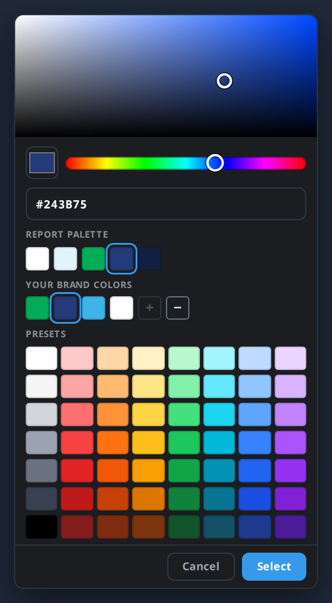

# Fonts and colors

Typography and color do most of the visual work in a report. This page covers how to choose and apply both.

## Block styles

**Block styles** sets the colors and fonts that every new block in a report starts with. In the builder's **Blocks** panel, click the palette icon next to **Standard** and **My Library** to open **Block styles**.

- **Preview:** a dark block and a light block drawn with the report's current colors and fonts, so you can see a change before you add anything.
- **Colors:** your brand kit [palettes](report-palettes.md), with your default marked **Default**. Pick one, or pick **Custom colors** to set the five colors yourself for just this report. Click a color to change it; your brand colors are in the picker. A note under the colors tells you if your Light and Dark colors are too close for readable text.
- **Fonts:** your brand kit [font pairs](font-pairs.md), each shown in its own typeface. Pick one, or pick **Custom fonts** to choose a heading font and a body font for just this report.
- **Save as a palette in Brand Kit** and **Save as a font pair in Brand Kit** appear under the custom options. They add your choice to the brand kit so the whole team can use it.
- **Also restyle the blocks in this section:** turn this on before clicking **Done** to apply the new colors and fonts to the blocks already in the section you're editing. It replaces colors, fonts and sizes set by hand on those blocks; words and images stay. Other sections aren't touched.
- **Advanced text styles** opens the detailed settings for each text style (sizes, weights, colors). **Manage block library** opens your saved blocks.

Colors and fonts are separate choices: picking a palette never changes your fonts. If your brand kit has no palettes or font pairs yet, Block styles offers a palette arranged from your brand colors and your brand's default fonts, with a link to the brand kit.

## Fonts

### The font library

Storyraise's font picker is backed by the Google Fonts library — hundreds of professionally designed typefaces. Search by name and preview each font live before choosing.

### Your brand fonts

Save your brand's heading and body fonts as a [font pair](font-pairs.md) in the brand kit. Your default pair is preselected whenever someone creates a report, so the whole team starts in the same two typefaces without hunting through the library. You can also upload your own font files there. Uploaded fonts are listed first in every font picker.

To change a report's fonts after it's created, open **Block styles** (above) and pick a font pair under **Fonts**, or choose **Custom fonts**.

### Per-element typography

Each text element can also be tuned individually: size, weight, color, alignment, line height, and letter spacing. Use this for fine-tuning — lean on your brand fonts for the big decisions.

The **Weight** control names each weight rather than numbering it — Light, Regular, Medium, Semibold, Bold — and only offers the weights the font family actually has. If a weight you expect isn't in the list, that family doesn't publish it. Every weight a family does offer is loaded with the report, so a heading set in Bold renders in real Bold rather than a browser's thickened approximation of Regular.

### Choosing fonts that work

- Pair a distinctive heading font with a quiet, highly readable body font.
- If your brand guidelines name fonts that exist in Google Fonts, use those exact ones. If not, pick the closest match — e.g., Lato or Inter stand in well for Helvetica-family brands.
- Body text reads best at a comfortable size with generous line height; resist shrinking text to fit more in.

## Colors

### Where colors come from

When you change an element's color in the builder, its color picker opens. At the top, drag in the color area and hue bar, or type any hex value. Below that are three rows:

- **Report palette** — the five colors this report was built with (see [Report palettes](report-palettes.md)).
- **Your brand colors** — from your [brand kit](brand-kit.md). The **+** and **−** at the end of this row add the color you've picked to the brand kit, or remove a brand color, for the whole team.
- **Presets** — a grid of Storyraise's built-in colors.

### What you can color

- **Section and block backgrounds** — the biggest lever for visual variety. Alternating background colors between sections gives a report rhythm.
- **Text** — headings and body text color per element.
- **Elements** — buttons, infographics, counters, and dividers take color settings too.

You can also restyle a whole block at once instead of coloring each element. Select the block and choose **Primary** (a dark section) or **Secondary** (a light section) under **Set Block Style**. To change the colors new blocks start with, pick a palette in **Block styles** (see the top of this page).

### Color tips

- **Contrast is king.** Dark text on light backgrounds (or the reverse) keeps your report readable for everyone — see [Accessibility considerations](accessibility.md).
- **Use your brightest color sparingly.** Save your brightest brand color for buttons, links, and key stats so it draws the eye where it matters.
- **Check on mobile.** Colors that look subtle on a big screen can disappear on a phone — preview both. See [Mobile optimization](mobile-optimization.md).

## Related

- [Brand kit](brand-kit.md)
- [Report palettes](report-palettes.md)
- [Font pairs](font-pairs.md)
- [Accessibility considerations](accessibility.md)
